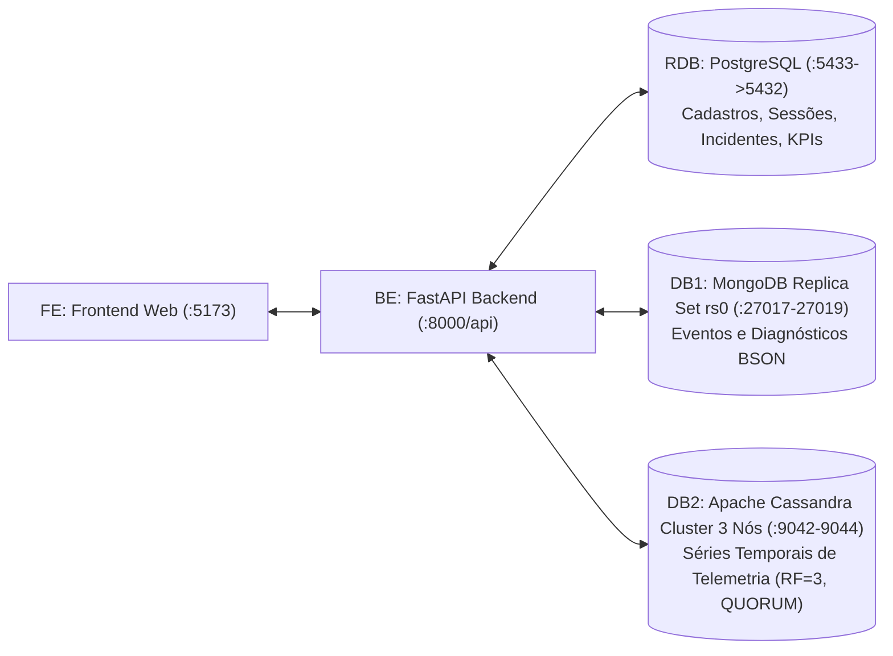

# LanHouse Monitor

Sistema de gerenciamento e monitoramento de computadores para ambientes como lan houses, laboratórios de informática e salas com múltiplas estações de trabalho.

O projeto tem como objetivo centralizar o acompanhamento das máquinas, permitindo consultar suas configurações técnicas, softwares instalados, períodos de utilização, incidentes, manutenções e métricas de desempenho.

A aplicação utiliza uma arquitetura com um frontend, um backend e três bancos de dados com diferentes modelos de armazenamento, cada um responsável por um conjunto específico de informações.

> **Para rodar o projeto:** vá direto para a [seção 12 — Como executar o projeto](#12-como-executar-o-projeto).
> Resumo (Windows, com Docker Desktop aberto e Python instalado): dê dois cliques em **`iniciar_tudo.bat`** e abra <http://localhost:5173>.

---

## 1. Objetivos do projeto

- Gerenciar o cadastro técnico das máquinas.
- Consultar os softwares instalados em cada computador.
- Registrar períodos de utilização das máquinas.
- Acompanhar incidentes e manutenções.
- Monitorar métricas de hardware e rede.
- Armazenar eventos e diagnósticos técnicos.
- Disponibilizar informações por meio de uma interface centralizada.

## 2. Integrantes

- Enrico Nascimento
- Guilherme Xavier
- Rafael Almeida

---

## 3. Arquitetura do sistema

O sistema será desenvolvido utilizando três componentes principais:

- **Frontend:** interface responsável pela interação com o operador e pela apresentação das informações.
- **Backend:** responsável pelas regras de negócio, processamento das solicitações e comunicação com os bancos de dados.
- **Bancos de dados:** responsáveis pelo armazenamento das informações, divididas conforme a natureza dos dados.

### 3.1. Visão geral

```text
                 FRONTEND
          (HTML + CSS + JS)
                    |
                    |
                 BACKEND
             (Python / FastAPI)
                    |
          +---------+---------+
          |         |         |
          v         v         v
      PostgreSQL  MongoDB  Cassandra
       Relacional  Documentos  Colunas
```

Cada banco possui uma responsabilidade específica, evitando que diferentes tipos de informação sejam armazenados de maneira inadequada.

---

## 4. Bancos de dados

### 4.1. PostgreSQL

**Modelo:** Banco de dados relacional.

**Responsabilidade:** Armazenar informações estruturadas e que possuem relacionamentos entre si.

Principais informações:

- Cadastro técnico das máquinas.
- Especificações de hardware.
- Catálogo de softwares.
- Associação entre máquinas e softwares instalados.
- Períodos de utilização das máquinas, sem identificação de usuários.
- Registro de incidentes.
- Histórico de manutenções.
- Informações do contrato de internet.

**Motivo da escolha:**

O PostgreSQL oferece suporte a transações, integridade referencial, restrições e relacionamentos entre tabelas. Essas características são importantes para manter a confiabilidade dos dados administrativos e técnicos do sistema.

### 4.2. MongoDB

**Modelo:** Banco de dados NoSQL orientado a documentos.

**Responsabilidade:** Armazenar eventos técnicos, logs e diagnósticos das máquinas.

Principais informações:

- Eventos registrados durante a utilização dos computadores.
- Registros de erros e falhas.
- Diagnósticos técnicos.
- Informações complementares sobre ocorrências.
- Registros com estruturas que podem variar conforme o tipo de evento.

**Motivo da escolha:**

O MongoDB utiliza documentos BSON, permitindo armazenar informações com estruturas flexíveis. Isso facilita o registro de diferentes tipos de eventos técnicos sem exigir que todos possuam exatamente os mesmos campos.

### 4.3. Apache Cassandra

**Modelo:** Banco de dados NoSQL orientado a colunas largas (*wide-column store*).

**Responsabilidade:** Armazenar métricas e informações de monitoramento das máquinas ao longo do tempo.

Principais informações:

- Consumo de CPU.
- Utilização de memória RAM.
- Utilização do armazenamento.
- Tráfego e utilização da rede.
- Estado de funcionamento das máquinas.
- Programas em execução e último horário de execução.
- Informações temporais de monitoramento.

**Motivo da escolha:**

O Cassandra foi escolhido por sua arquitetura distribuída, capacidade de escrita em grande volume e suporte a replicação. Essas características são adequadas para o armazenamento contínuo de métricas produzidas pelas máquinas monitoradas.

---

## 5. Tecnologias e linguagens

| Componente | Tecnologia | Justificativa |
|---|---|---|
| Frontend | HTML + CSS + JavaScript (ES Modules, sem framework) | Interface leve, sem etapa de build nem `npm install`: basta um servidor de arquivos estáticos. |
| Backend | Python + FastAPI | Desenvolvimento simplificado de APIs REST e facilidade de integração. |
| Servidor da API | Uvicorn | Execução da aplicação FastAPI por meio do protocolo ASGI. |
| Banco relacional | PostgreSQL / SQL | Manipulação de dados estruturados e relacionamentos. |
| Banco documental | MongoDB / BSON | Armazenamento flexível de eventos e logs. |
| Banco distribuído | Cassandra / CQL | Armazenamento distribuído de métricas temporais. |

O backend será responsável por intermediar toda a comunicação entre o frontend e os três bancos de dados.

---

## 6. Teorema CAP e disponibilidade

O teorema CAP estabelece que, diante de uma partição de rede em um sistema distribuído, não é possível garantir simultaneamente:

- **Consistency (Consistência):** todos os nós apresentam os dados mais recentes de maneira consistente.
- **Availability (Disponibilidade):** toda solicitação a um nó que não falhou recebe uma resposta.
- **Partition Tolerance (Tolerância a partições):** o sistema continua operando mesmo quando ocorre uma falha de comunicação entre nós.

No projeto, a indisponibilidade de um banco poderá afetar somente as funcionalidades que dependem diretamente dele, desde que não exista uma operação que necessite consultar simultaneamente os três bancos.

### 6.1. PostgreSQL

O PostgreSQL será utilizado inicialmente como uma instância relacional.

Caso fique indisponível, as funcionalidades que dependem de seus dados, como consulta às máquinas cadastradas, softwares, incidentes e manutenções, ficarão temporariamente indisponíveis.

Como não foi definida uma configuração de replicação para esse banco, sua recuperação dependerá do restabelecimento da instância ou de uma estratégia adicional de recuperação.

### 6.2. MongoDB

O MongoDB utilizará um Replica Set com três membros.

Caso o membro primário fique indisponível, os membros restantes poderão realizar uma eleição para escolher um novo primário.

Durante esse processo, as operações de escrita poderão ficar temporariamente indisponíveis.

Com três membros votantes, dois votos são necessários para formar a maioria. Portanto, uma instância poderá ficar indisponível sem impedir a eleição de um novo primário.

### 6.3. Cassandra

O Cassandra utilizará três nós, com fator de replicação igual a três.

Isso significa que cada dado terá três réplicas distribuídas entre os nós.

Será utilizado o nível de consistência `QUORUM`, que exige respostas de pelo menos duas réplicas para concluir uma operação de leitura ou escrita.

Assim, uma instância poderá ficar indisponível e ainda será possível atingir o quórum. Caso duas instâncias fiquem indisponíveis, as operações que exigem esse nível de consistência não poderão ser concluídas.

---

## 7. Consistência dos dados

Cada banco utiliza mecanismos próprios para garantir a confiabilidade das informações.

### 7.1. PostgreSQL

O PostgreSQL utiliza as propriedades ACID:

- **Atomicidade:** uma transação é executada integralmente ou não é executada.
- **Consistência:** as operações respeitam as restrições e regras definidas no banco.
- **Isolamento:** transações simultâneas não devem interferir indevidamente umas nas outras.
- **Durabilidade:** transações confirmadas permanecem armazenadas mesmo após falhas.

### 7.2. MongoDB

O MongoDB oferece mecanismos configuráveis de consistência por meio de:

- **Read Concern:** define o nível de garantia dos dados retornados nas leituras.
- **Write Concern:** define quantas confirmações são necessárias para considerar uma escrita concluída.
- **Replica Set:** mantém cópias dos dados em diferentes membros e permite a eleição de um novo primário em caso de falha.

A configuração desses mecanismos permite controlar o equilíbrio entre consistência, desempenho e disponibilidade.

### 7.3. Cassandra

O Cassandra permite definir níveis de consistência para operações de leitura e escrita.

Neste projeto, será utilizado `QUORUM`, exigindo respostas da maioria das réplicas disponíveis para concluir as operações.

Com fator de replicação três, duas respostas são suficientes para atingir o quórum.

Quando leitura e escrita utilizam `QUORUM`, a interseção entre as réplicas consultadas permite obter consistência forte para essas operações, considerando que não haja outras condições de concorrência ou falhas que invalidem essa garantia.

---

## 8. Replicação e tolerância a falhas

Os bancos não relacionais utilizarão três instâncias para distribuir os dados e reduzir o impacto de falhas individuais.

### 8.1. MongoDB – Replica Set

Configuração planejada:

- 3 membros votantes.
- 1 membro primário.
- 2 membros secundários.
- Replicação dos dados entre os membros.

Com essa configuração, uma instância poderá ficar indisponível e ainda será possível manter a maioria necessária para a eleição de um novo primário.

Caso duas instâncias fiquem indisponíveis, o membro restante não terá maioria para eleger um primário, impedindo novas operações de escrita.

### 8.2. Cassandra – Replicação

Configuração planejada:

- 3 nós.
- Fator de replicação igual a 3.
- Nível de consistência `QUORUM`.

Com três réplicas, duas respostas são necessárias para concluir uma operação.

| Instâncias indisponíveis | Réplicas restantes | Operações com QUORUM |
|---|---:|---|
| 0 | 3 | Disponíveis |
| 1 | 2 | Disponíveis |
| 2 | 1 | Indisponíveis |

Dessa maneira, o Cassandra poderá continuar realizando operações que exigem `QUORUM` mesmo com a indisponibilidade de um dos nós.

### 8.3. Resumo da tolerância a falhas

| Banco | Configuração | Instâncias indisponíveis toleradas |
|---|---|---:|
| PostgreSQL | Instância única, sem replicação definida | 0 |
| MongoDB | Replica Set com 3 membros | 1 |
| Cassandra | 3 nós, fator de replicação 3 e QUORUM | 1 |

---

## 9. Organização dos dados

A separação das informações entre os bancos seguirá a seguinte lógica:

| Informação | Banco responsável |
|---|---|
| Cadastro técnico das máquinas | PostgreSQL |
| Especificações de hardware | PostgreSQL |
| Softwares instalados | PostgreSQL |
| Períodos de utilização | PostgreSQL |
| Incidentes e manutenções | PostgreSQL |
| Contrato de internet | PostgreSQL |
| Eventos técnicos e logs | MongoDB |
| Diagnósticos técnicos | MongoDB |
| Consumo de CPU e RAM | Cassandra |
| Utilização de disco e rede | Cassandra |
| Estado observado das máquinas | Cassandra |
| Programas em execução e horários | Cassandra |

Essa divisão busca utilizar as características de cada banco de dados de acordo com o tipo de informação armazenada.

---

## 10. Considerações finais

O LanHouse Monitor propõe uma arquitetura que combina diferentes modelos de bancos de dados para atender às necessidades de gerenciamento e monitoramento de computadores.

O PostgreSQL será responsável pela integridade das informações estruturadas, o MongoDB pelo armazenamento flexível de eventos e diagnósticos, e o Cassandra pelo armazenamento distribuído de métricas temporais.

A utilização conjunta dessas tecnologias permite explorar diferentes estratégias de persistência, consistência, replicação e tolerância a falhas em uma aplicação prática.


---

## 11. Estrutura de Implementação do Backend e Fluxo Poliglota

Seguindo o modelo de **Persistência Poliglota** (`FE <--> BE`, `BE <--> RDB`, `BE <--> DB1`, `BE <--> DB2`), o Backend em `Backend/app/` foi organizado em módulos desacoplados por banco de dados:



- **Serviço Relacional (`RDB` — PostgreSQL)**:
  - Conexão e extensão de schema em `Backend/app/database/postgres.py`.
  - Rotas CRUD completas em `routers/machines.py`, `routers/sessions.py`, `routers/resources.py` (`/users`, `/plans`, `/programs`, `/incidents`, `/maintenances`) e `routers/reports.py`.
- **Serviço Documental (`DB1` — MongoDB)**:
  - Conexão com descoberta automática do nó primário do Replica Set `rs0` em `Backend/app/database/mongodb.py`.
  - Rotas CRUD completas de documentos de eventos em `routers/events.py` e gravação transversal resiliente em `services/event_logger.py` (garantindo que a queda do MongoDB retorne avisos `_warnings` sem interromper as transações ACID do PostgreSQL).
- **Serviço Colunar (`DB2` — Apache Cassandra)**:
  - Modelagem CQL oficial em `Banco/Cassandra/01_ddl_lanhouse.cql` (`NetworkTopologyStrategy` com `replication_factor: 3`, tabela histórica `metrics_by_machine` particionada por `(machine_id, day)` com `CLUSTERING ORDER BY (ts DESC)` e tabela de última leitura `latest_metrics_by_machine`).
  - Conexão distribuída com failover automático entre as portas do host (`9042`, `9043`, `9044`), consistência `ConsistencyLevel.QUORUM` (2 de 3 réplicas), seed histórico de 7 dias e coletor em tempo real (a cada 10s) em `services/cassandra_service.py` e `routers/metrics.py` (incluindo CRUD completo via `GET`, `POST`, `PUT` e `DELETE /machines/{id}/metrics`).

---

## 12. Como executar o projeto

Esta seção é um roteiro completo para rodar o LanHouse Monitor **em qualquer computador, do zero**. Os três bancos sobem em containers Docker já populados com dados de exemplo; o back-end e o front-end rodam com Python.

### 12.1. Pré-requisitos

| Programa | Versão | Para quê | Onde baixar |
|---|---|---|---|
| **Docker Desktop** (Windows/macOS) ou Docker Engine + Compose v2 (Linux) | Docker Compose v2 (comando `docker compose`) | Sobe PostgreSQL, MongoDB (3 nós) e Cassandra (3 nós) | <https://www.docker.com/products/docker-desktop/> |
| **Python** | 3.10 a 3.14 (testado com 3.14) | Back-end FastAPI e servidor do front-end | <https://www.python.org/downloads/> — no Windows, marque **"Add python.exe to PATH"** |
| Navegador | Chrome, Edge ou Firefox atuais | Painel web | — |

Requisitos da máquina:

- **Memória:** o cluster Cassandra de 3 nós usa cerca de 3 GB. Reserve **pelo menos 4 GB de RAM para o Docker** (Docker Desktop → *Settings → Resources*; no Windows com WSL 2 o padrão costuma ser suficiente).
- **Internet** na primeira execução: o Docker baixa as imagens (cerca de 1 GB) e o `pip` instala as dependências do back-end.
- **Portas livres:** `5173` (front-end), `8000` (API), `5433` (PostgreSQL), `27017–27019` (MongoDB) e `9042–9044` (Cassandra).

> O PostgreSQL usa a porta **5433** no computador (e não a 5432) para não conflitar com um PostgreSQL que já esteja instalado no Windows.

### 12.2. Baixar o projeto

Escolha uma das opções:

- **ZIP:** na página do repositório no GitHub (<https://github.com/GuilhermeXavier2005/LanHouse>), clique em **Code → Download ZIP** e extraia o arquivo. Use a pasta extraída que contém o `docker-compose.yml` (por exemplo, `LanHouse-main`).
- **Git:**

  ```bash
  git clone https://github.com/GuilhermeXavier2005/LanHouse.git
  cd LanHouse
  ```

Todos os comandos abaixo devem ser executados **na pasta raiz do projeto** (a que contém `docker-compose.yml`, `Backend/`, `Frontend/` e `Banco/`).

### 12.3. Jeito rápido (Windows): um clique

1. Abra o **Docker Desktop** e espere aparecer *Engine running*.
2. Dê dois cliques em **`iniciar_tudo.bat`** (na raiz do projeto). Ele:
   - sobe os 7 containers dos bancos e espera todos ficarem saudáveis (na primeira vez leva de **3 a 6 minutos**, por causa do download das imagens e do Cassandra);
   - abre uma janela com o **back-end** (cria o ambiente virtual Python e instala as dependências na primeira vez);
   - abre uma janela com o servidor do **front-end** e o navegador em <http://localhost:5173>.
3. Mantenha as janelas abertas enquanto usa o sistema. Se o painel abrir antes de o back-end terminar de instalar, aguarde e aperte **F5**.

Se preferir fazer etapa por etapa (ou estiver em Linux/macOS), siga a seção 12.4.

### 12.4. Passo a passo manual

#### Passo 1 — Subir os bancos de dados

```bash
docker compose up -d
```

O Compose cria e inicializa tudo automaticamente:

| Container | Porta no computador | O que faz |
|---|---|---|
| `lanhouse-postgres` | 5433 | PostgreSQL 16. Na **primeira** subida executa `Banco/PostgreSql/01_ddl_lanhouse.sql` (tabelas) e `02_dml_lanhouse.sql` (dados de exemplo). |
| `lanhouse-mongo1`, `lanhouse-mongo2`, `lanhouse-mongo3` | 27017, 27018, 27019 | MongoDB 7 em Replica Set `rs0` (3 membros). |
| `lanhouse-mongo-init` | — | Executa uma vez `rs.initiate(...)` para criar o Replica Set e encerra (status *Exited (0)* é o esperado). |
| `lanhouse-cassandra1`, `lanhouse-cassandra2`, `lanhouse-cassandra3` | 9042, 9043, 9044 | Cluster Cassandra 4.1 com 3 nós (`LanHouseCluster`). Os nós sobem em sequência. |
| `lanhouse-cassandra-init` | — | Executa uma vez `Banco/Cassandra/01_ddl_lanhouse.cql` (keyspace com RF = 3 e tabelas) e encerra. |

Acompanhe até os serviços aparecerem como `healthy` (o Cassandra leva de 2 a 4 minutos):

```bash
docker compose ps
```

Conferir o anel do Cassandra (os 3 nós devem aparecer como `UN` = *Up/Normal*):

```bash
docker exec lanhouse-cassandra1 nodetool status
```

#### Passo 2 — Iniciar o back-end (FastAPI na porta 8000)

**Windows:** dois cliques em `iniciar_backend.bat`, ou no terminal:

```bash
cd Backend
py -3.14 -m venv .venv
.venv\Scripts\activate
pip install -r requirements.txt
copy .env.example .env
python run.py
```

> `py -3.14` escolhe o Python 3.14; troque por `-3.13`, `-3.12`… conforme a versão instalada (`py -0` lista as versões). O `iniciar_backend.bat` faz essa escolha sozinho.

**Linux/macOS:**

```bash
cd Backend
python3 -m venv .venv
source .venv/bin/activate
pip install -r requirements.txt
cp .env.example .env
python run.py
```

Ao iniciar, o back-end:

- complementa o schema do PostgreSQL (tabelas `usuarios` e `planos` e colunas extras, tudo com `IF NOT EXISTS`) e insere os dados complementares;
- insere eventos de exemplo no MongoDB, se a coleção estiver vazia;
- aguarda o quórum do Cassandra, garante o keyspace/tabelas, grava **7 dias de histórico de telemetria** e passa a gravar uma nova amostra a cada 10 segundos.

Endereços:

- API: <http://localhost:8000/api>
- Documentação interativa (Swagger): <http://localhost:8000/docs>
- Saúde dos bancos: <http://localhost:8000/api/health> → deve mostrar `"status": "ok"` e os três serviços `"up"`.

> Se o Cassandra aparecer `"down"` logo depois de subir os containers, é porque o cluster ainda está formando. O back-end tenta de novo sozinho a cada 5 segundos; não é preciso reiniciá-lo.

#### Passo 3 — Iniciar o front-end (porta 5173)

Em **outro** terminal (ou dois cliques em `Frontend/iniciar.bat`):

```bash
cd Frontend
py serve.py
```

(Em Linux/macOS: `python3 serve.py`.) Abra <http://localhost:5173>.

O painel já vem configurado para usar a **API real** (`http://localhost:8000/api`). O selo **"API real"** aparece no canto superior direito. Para conferir ou trocar, use o menu **Bancos & API → Fonte de dados**. O modo *Demonstração (mock)* existe só para apresentar a interface sem back-end; nele os dados ficam apenas no navegador.

> Abrir o `index.html` direto pelo explorador de arquivos não funciona: o navegador bloqueia módulos JavaScript em `file://`. Use sempre o `serve.py`.

### 12.5. Roteiro de uso (o que testar no painel)

| Tela | O que fazer | Banco envolvido |
|---|---|---|
| **Visão geral** | Indicadores do dia e mapa do salão com CPU/RAM ao vivo de cada máquina. | PostgreSQL + Cassandra |
| **Sessões** | *Nova sessão* → escolha máquina, usuário e plano → *Iniciar*. Depois *Encerrar*: o valor é calculado em blocos de 15 min e o pagamento é registrado. Tente iniciar uma sessão para um usuário que já está em sessão: a API recusa com uma mensagem (HTTP 409). | PostgreSQL (sessão) + MongoDB (eventos) |
| **Máquinas** | Cadastrar, editar, mudar estado (manutenção/offline) e ver detalhes (programas instalados, histórico, eventos e métricas). | PostgreSQL |
| **Métricas** | Última coleta de cada máquina e gráficos de CPU, GPU, RAM, disco, rede, latência e temperatura em 1 h, 6 h, 24 h ou 7 dias. | Cassandra (QUORUM) |
| **Eventos** | Linha do tempo de documentos BSON (sessão iniciada/encerrada, mudança de estado, incidente aberto…), com filtro e visualização do JSON. | MongoDB |
| **Incidentes / Manutenções** | Abrir, atender e resolver incidentes; registrar e concluir manutenções. | PostgreSQL |
| **Usuários / Planos / Programas** | Cadastros básicos (CRUD completo). | PostgreSQL |
| **Bancos & API** | Saúde e latência dos 3 bancos, dados do contrato de internet e a chave **Simular indisponibilidade** de cada banco (veja 12.7). | Todos |

### 12.6. Consultar os dados diretamente nos bancos

**PostgreSQL** (usuário `lanhouse`, senha `lanhouse`, banco `lanhouse`, porta `5433` — também funciona em pgAdmin/DBeaver):

```bash
docker exec -it lanhouse-postgres psql -U lanhouse -d lanhouse
```

```sql
\dt
SELECT id, codigo, grupo, status FROM maquinas;
SELECT * FROM sessoes_uso ORDER BY inicio DESC LIMIT 5;
```

**MongoDB** (Replica Set `rs0`):

```bash
docker exec -it lanhouse-mongo1 mongosh lanhouse
```

```javascript
rs.status().members.map(m => m.name + " " + m.stateStr)
db.events.find().sort({ timestamp: -1 }).limit(5)
```

**Cassandra** (keyspace `lanhouse`, RF = 3):

```bash
docker exec -it lanhouse-cassandra1 cqlsh
```

```sql
DESCRIBE KEYSPACE lanhouse;
CONSISTENCY QUORUM;
SELECT machine_id, hostname, ts, cpu_pct, ram_pct FROM lanhouse.latest_metrics_by_machine;
```

### 12.7. Testes de tolerância a falhas (Teorema CAP)

**Pela interface (simulação):** em **Bancos & API**, ligue *Simular indisponibilidade* em um banco. O back-end passa a responder `503 DB_UNAVAILABLE` para aquele banco e a interface mostra o aviso só nas áreas que dependem dele:

| Banco "fora" | Efeito esperado |
|---|---|
| PostgreSQL | Cadastros, sessões e mapa mostram erro; telemetria (Cassandra) e eventos (MongoDB) continuam. |
| MongoDB | A tela de Eventos mostra erro; sessões e cadastros **continuam funcionando** e a resposta traz o aviso de que o evento não foi gravado. |
| Cassandra | Gráficos e barras de CPU/RAM mostram aviso; o restante segue normal. |

Desligue a chave para restabelecer.

**Derrubando containers de verdade:**

Cassandra (3 nós, RF = 3, `QUORUM` exige 2 réplicas):

```bash
docker stop lanhouse-cassandra1
```

Com **1 nó parado**, a telemetria continua funcionando: o back-end troca de coordenador (portas 9042 → 9043/9044) e o `QUORUM` (2 de 3) é atingido.

```bash
docker stop lanhouse-cassandra2
```

Com **2 nós parados**, o `QUORUM` não é atingido: `/api/health` mostra o Cassandra `down` e as rotas de métricas respondem `503`, sem afetar PostgreSQL nem MongoDB.

MongoDB (Replica Set com 3 membros):

```bash
docker stop lanhouse-mongo1
```

Os membros restantes elegem um novo primário em alguns segundos e o back-end passa a gravar nele automaticamente (portas 27018/27019). Com 2 membros parados não há maioria para eleger primário: eventos ficam indisponíveis (`503`) e as sessões continuam com aviso.

Restabelecer tudo:

```bash
docker start lanhouse-cassandra1 lanhouse-cassandra2 lanhouse-mongo1
```

### 12.8. Teste automatizado da API

O arquivo `Backend/tests/teste_api.py` faz mais de 200 chamadas em todas as rotas (dados válidos e inválidos, conflitos, simulação de queda dos 3 bancos) e confere os códigos HTTP do contrato. Com os bancos e o back-end rodando:

```bash
cd Backend
.venv\Scripts\python tests\teste_api.py
```

(Linux/macOS: `.venv/bin/python tests/teste_api.py`.) O resultado esperado termina em `RESULTADO: OK - nenhuma falha.` Os registros criados pelo teste são excluídos ao final.

### 12.9. Parar, reiniciar e zerar os dados

| Objetivo | Comando |
|---|---|
| Parar o back-end/front-end | Feche as janelas ou pressione `Ctrl+C` |
| Parar os bancos (mantém os dados) | `docker compose stop` |
| Subir de novo depois | `docker compose up -d` |
| Remover os containers (mantém os dados nos volumes) | `docker compose down` |
| **Zerar tudo** e voltar aos dados de exemplo | `docker compose down -v` e depois `docker compose up -d` |

> Os scripts de `Banco/PostgreSql` só rodam quando o volume do PostgreSQL está vazio. Para reaplicá-los, use `docker compose down -v`.

### 12.10. Solução de problemas

| Sintoma | Causa provável e solução |
|---|---|
| `docker: error during connect` / *cannot find the file specified* | O Docker Desktop não está aberto. Abra-o e espere *Engine running*. |
| `port is already allocated` ao subir os containers | Outro programa usa uma das portas da seção 12.1. Feche-o (ou pare outro container com `docker ps` / `docker stop <nome>`). |
| Cassandra não fica `healthy` / reinicia sozinho | Falta de memória para o Docker. Aumente para 4 GB ou mais em *Settings → Resources* e rode `docker compose up -d` de novo. |
| `/api/health` mostra MongoDB `down` | Veja se o Replica Set foi criado: `docker logs lanhouse-mongo-init`. Para repetir a inicialização: `docker compose up -d mongo-init-replica`. |
| Painel mostra **"API indisponível"** | O back-end não está rodando ou ainda está iniciando. Confira <http://localhost:8000/api/health> e a janela do back-end. |
| Painel mostra dados diferentes dos bancos | Ele pode estar no modo *Demonstração (mock)*. Vá em **Bancos & API → Fonte de dados → API real → Salvar e recarregar**. |
| `python` não é reconhecido | Reinstale o Python marcando *Add python.exe to PATH*, ou use `py` no lugar de `python`. |
| Erro ao instalar `cassandra-driver` | Use Python 3.10 a 3.14. Versões mais novas podem não ter pacote pronto da biblioteca. |

### 12.11. Estrutura de pastas

```text
LanHouse/
├── docker-compose.yml          bancos: PostgreSQL, MongoDB (3 nós) e Cassandra (3 nós)
├── iniciar_tudo.bat            Windows: sobe bancos + back-end + front-end
├── iniciar_backend.bat         Windows: cria o venv, instala dependências e roda a API
├── Banco/
│   ├── PostgreSql/             01_ddl (tabelas) e 02_dml (dados de exemplo)
│   └── Cassandra/              01_ddl (keyspace RF=3 e tabelas de métricas)
├── Backend/
│   ├── .env.example            configuração (portas e credenciais dos bancos)
│   ├── requirements.txt
│   ├── run.py                  inicia o Uvicorn na porta 8000
│   ├── app/
│   │   ├── main.py             FastAPI, CORS e tratamento padronizado de erros
│   │   ├── schemas.py          validações compartilhadas (limites e domínios dos campos)
│   │   ├── database/           conexões PostgreSQL, MongoDB (failover) e simulação de queda
│   │   ├── routers/            rotas REST (máquinas, sessões, cadastros, eventos, métricas…)
│   │   └── services/           Cassandra (QUORUM, seed, coletor) e gravação de eventos
│   └── tests/teste_api.py      teste de ponta a ponta da API
└── Frontend/
    ├── index.html, css/, js/   painel web (HTML + CSS + JavaScript puro)
    ├── serve.py, iniciar.bat   servidor local na porta 5173
    └── API.md                  contrato da API usado pelo front-end
```
